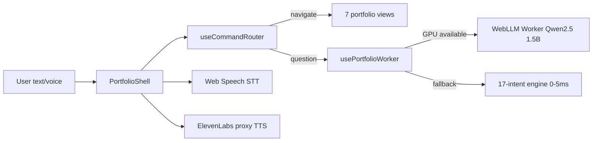

# MyPortfolio-AI - AI-Augmented Web Portfolio

<p align="center">
  
</p>

> **Berlin-based Technical Operations & Integration Specialist.** Multi-view
> interactive portfolio featuring a browser-native AI guide (Qwen2.5-Instruct)
> and voice interaction. Built with Next.js 16.2.12, React 19, Tailwind CSS v4.
> Runs client-side via WebLLM/WebGPU. 🧠

[](https://github.com/shahriarhaqueabir/ShahriarHaqueAbirPortfolio/actions/workflows/ci.yml)
[](https://nextjs.org)
[](https://www.typescriptlang.org)
[](https://tailwindcss.com)
[](https://motion.dev)
[](https://github.com/mlc-ai/web-llm)
[](https://elevenlabs.io)
[](https://playwright.dev)
[](https://vercel.com)

**[Live Demo](https://shahriarhaqueabirportfolio.vercel.app)** |
**[LinkedIn](https://www.linkedin.com/in/shahriarhaqueabir)** |
**[GitHub](https://github.com/shahriarhaqueabir)**

---

## Fun things you can do

- Make your portfolio answer questions out loud - visitors ask, it speaks back
- Turn on a local AI that runs on the visitor's GPU (no server bill)
- Navigate your own site by voice: "show me your projects"

## 🎬 The story — why this exists

A static portfolio is a brochure. This one is a _conversation_: a browser-native
AI guide (Qwen2.5-Instruct 1.5B via WebLLM) answers questions about projects,
skills, and experience — fully client-side, no model-serving API. Voice in
(Web Speech API), voice out (ElevenLabs TTS). Seven views, orbital navigation,
a dark terminal aesthetic. Built to show, not just tell. 🧠🎤

> 💡 **The one sentence that drove everything:** _A portfolio should answer
> questions, not just display pages._

---

## 🔁 The feedback loop (zero → finished)

```
  1. 🎯 SCOPE     define views, content, AI intents
  2. ⚛️  SCAFFOLD  Next.js 16 + TS + Tailwind v4 + Motion
  3. 🧠 AI        WebLLM worker + 17-intent fallback engine
  4. 🎤 VOICE     STT (Web Speech) + TTS (ElevenLabs proxy)
  5. 🎨 UI        glass panels, orbit constellation, view transitions
  6. 🧪 TEST      Playwright E2E, hydration safety, cross-browser quirks
  7. 🚢 DEPLOY    Vercel, env vars, SEO, JSON-LD
  8. 🔁 REPEAT    iterate on content, AI intents, UX
```

> 🧠 **Secret of the loop:** the fallback engine always works (0–5ms, no GPU).
> The LLM is an _upgrade_, not a dependency. The site never breaks if WebGPU
> is unavailable.

---

## 🏗️ Architecture — how the pieces talk



```text
User input (text or voice)
        │
        ▼
useCommandRouter ──► Is it a navigation command?
        │                    │
        │ Yes                │ No
        ▼                    ▼
  Navigate view        usePortfolioWorker
                                │
                         ┌──────┴──────┐
                         │              │
                    localAiEnabled?   fallback-engine.ts
                         │          (pattern match, 0–5ms)
                         ▼
               Web Worker (worker.ts)
               Qwen2.5-Instruct 1.5B via WebLLM
               ~950MB download, WebGPU
```

| Component      | Responsibility                                                     | Key file                |
| -------------- | ------------------------------------------------------------------ | ----------------------- |
| 🐚 Shell       | Owns panel state, input, voice hooks, send logic                   | `PortfolioShell.tsx`    |
| 🧭 Router      | Text → navigation/command detection                                | `useCommandRouter.ts`   |
| 🧠 Worker      | WebLLM lifecycle, fallback/LLM dual response                       | `usePortfolioWorker.ts` |
| 🎤 Voice in    | Web Speech API wrapper (STT)                                       | `useVoiceInput.ts`      |
| 🔊 Voice out   | ElevenLabs TTS wrapper                                             | `useVoiceOutput.ts`     |
| 🎛️ VoiceButton | Mic + speaker button (always `<button>`)                           | `VoiceButton.tsx`       |
| 📊 Views       | 7 views: Hero, About, Projects, Experience, Skills, Stats, Contact | `views/*.tsx`           |

---

## 🏆 Good choices (and why they were good)

1. **🧠 Fallback-first AI.** 17-intent pattern engine works instantly with no
   GPU/download. LLM is an upgrade, never a dependency.
2. **🎤 Voice as progressive enhancement.** STT via browser API, TTS via
   proxy. Works without ElevenLabs key (just no voice out).
3. **🧩 Lifted state.** `PortfolioShell` owns input/voice and passes down —
   single source of truth, no dual-interface confusion.
4. **🔒 API key server-side.** ElevenLabs key read from `process.env` at
   request time, never committed.
5. **⚛️ WebLLM in a Web Worker.** Inference off the main thread, UI stays
   responsive.
6. **📏 500-char TTS cap.** Protects the ~10K char/month free tier from
   accidental overuse.
7. **🎧 400ms SpeechRecognition restart.** Prevents rate-limiting on Brave
   which fires `onend` after short pauses.
8. **⚛️ Always render `<button>`.** Never `null` — prevents React hydration
   mismatches.

---

## 📋 The playbook — recreate from zero

### Phase 0 — Scope 🎯

1. One sentence: _"A portfolio should answer questions, not just display pages."_
2. Boundaries: client-side AI, no model-serving API, voice optional.

### Phase 1 — Skeleton 🦴

3. Next.js 16 App Router + TypeScript 5.8 + Tailwind v4.
4. SSG for all views. Webpack build (no Turbopack — WebLLM aliases).
5. Content centralized in `src/lib/data.ts`.

### Phase 2 — AI layer 🧠

6. Web Worker with WebLLM engine singleton.
7. 17-intent fallback engine (0–5ms, no GPU).
8. `usePortfolioWorker` orchestrates lifecycle + download progress.

### Phase 3 — Voice 🎤

9. `useVoiceInput`: Web Speech API, continuous, interim results.
10. `useVoiceOutput`: ElevenLabs proxy, in-memory cache, 500-char cap.
11. `VoiceButton`: discriminated union, always a `<button>`.

### Phase 4 — UI/UX 🎨

12. Seven views with command-based routing.
13. Glass panels, orbit constellation, grid textures.
14. Particle background, smooth scroll (Lenis).

### Phase 5 — SEO & deploy 🚢

15. JSON-LD, sitemap, robots, Open Graph.
16. Vercel deploy with env var.

---

## ⚠️ Mistakes to avoid

- 🚫 **Turbopack.** Webpack aliases (`sharp$`, `onnxruntime-node$`) needed
  for WebLLM; Turbopack incompatible.
- 🚫 **`watchOptions.poll` in dev.** Causes infinite Fast Refresh loop on
  Windows. Never add it back.
- 🚫 **Auto-play TTS.** Disruptive. User clicks speaker.
- 🚫 **Hydration mismatches.** Browser API checks in `useEffect`, not render.
  Always render `<button>`.
- 🚫 **Committing the API key.** Read from `process.env` at request time.
- 🚫 **No fallback for AI.** The site must work without WebGPU.

---

## 🧰 Stack

| Layer         | Technology                        | Why                     |
| ------------- | --------------------------------- | ----------------------- |
| ⚛️ Framework  | Next.js 16.2.12 (App Router, SSG) | Static gen + API routes |
| 📝 Language   | TypeScript 5.8                    | Strict typing           |
| 🎨 Styling    | Tailwind CSS 4                    | CSS-first config        |
| ✨ Animation  | Motion 12                         | Fluid transitions       |
| 🧠 AI runtime | WebLLM 0.2.83 (MLC)               | In-browser inference    |
| 🤖 AI model   | Qwen2.5-Instruct 1.5B (q4f16_1)   | ~950MB, WebGPU          |
| 🎤 STT        | Web Speech API                    | Browser-native          |
| 🔊 TTS        | ElevenLabs (proxied)              | High-quality voice      |
| ✨ Particles  | tsParticles (slim)                | Lightweight effects     |
| 🔤 Fonts      | Syne, JetBrains Mono              | Distinctive pairing     |
| 📜 Scroll     | Lenis                             | Smooth scrolling        |
| 🧪 E2E        | Playwright                        | Cross-browser testing   |
| 🚢 Deploy     | Vercel                            | Edge + SSG              |

## 🛠️ Provisioning

```bash
# Prereqs: Node.js 20+, npm
git clone https://github.com/shahriarhaqueabir/MyPortfolio-AI.git
cd MyPortfolio-AI
npm install

# Optional: voice out (ElevenLabs)
# create .env with:
# ELEVENLABS_API=sk_...
```

## ⚡ Quick command reference

```bash
npm run dev          # http://localhost:3000
npm run build        # TS check + production build
npx playwright test  # E2E (headless)
npm run lint         # ESLint
npm run format       # Prettier
```

## 🚀 Getting started

```bash
npm install
# create .env with ELEVENLABS_API=sk_... (optional)
npm run dev        # http://localhost:3000
npm run build      # TS check + production build
npx playwright test # E2E (headless)
npm run lint       # ESLint
npm run format     # Prettier
```

## 📟 Portfolio views

| View          | Route         | Purpose                                               |
| ------------- | ------------- | ----------------------------------------------------- |
| 🏠 Hero       | `/`           | Identity, headline rotator, stats, recruiter snapshot |
| 👤 About      | `/about`      | Personal narrative + adjacent-role context            |
| 📁 Projects   | `/projects`   | Case studies with detailed breakdowns                 |
| 💼 Experience | `/experience` | Chronological timeline + career influence map         |
| 🛠️ Skills     | `/skills`     | Capability map across 5 domains                       |
| 📊 Stats      | `/stats`      | Key metrics, working-style orbit constellation        |
| 📬 Contact    | `/contact`    | Contact channels, work authorization                  |

## 🎤 Voice system

- **STT:** Web Speech API (`SpeechRecognition`), continuous + interim results.
  Brave fires `onend` after short pauses → 400ms restart delay.
- **TTS:** ElevenLabs proxy at `/api/tts`, 500-char cap, in-memory cache.
  Default voice: Laura (Enthusiast, Quirky Attitude).
- **VoiceButton:** discriminated union (input/speaker), always renders
  `<button>` to prevent hydration mismatch.

## 📸 Screenshots

| View 1 | View 2 | View 3 |
|---|---|---|
|  |  |  |

> Add your own screenshots under docs/screenshots/.

## 📌 TL;DR

- **Problem:** static portfolios that cannot answer questions.
- **Solution:** Next.js 16 portfolio with browser-native AI guide (WebLLM) and voice I/O.
- **Why it is interesting:** shows how to ship a client-side LLM in a static site with a fallback engine.


## 📜 License

MIT — see LICENSE.

---

## 🚫 No contributions — personal portfolio

This is a **personal portfolio** and is **not open for contributions, issues, or
feature requests**. Feel free to fork it, study the architecture, and adapt
patterns for your own projects. 🍴
